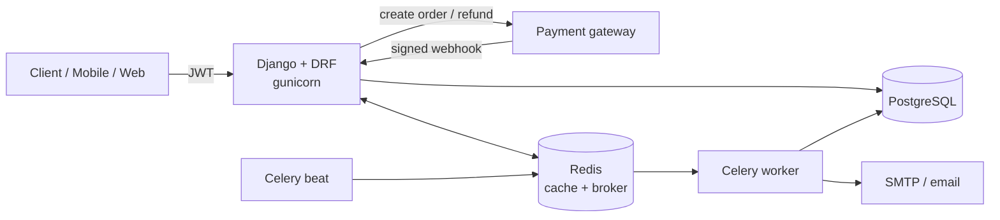
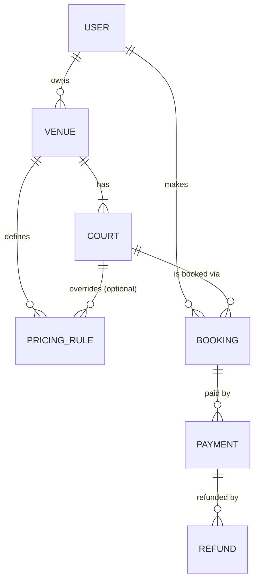
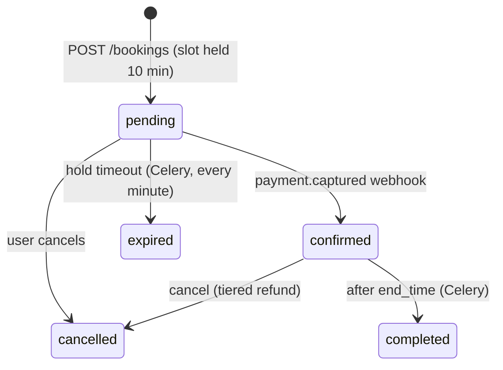

# SlotBook — Smart Turf & Court Booking Platform

A multi-venue booking and management backend for sports facilities (turfs, courts, arenas).
Built with **Django 5 · Django REST Framework · PostgreSQL · Redis · Celery**, containerised with **Docker**.

SlotBook solves the problems that actually hurt booking businesses: **double bookings**, **unpaid slot-hogging**,
**payment/webhook races**, **manual refunds**, and **no visibility into revenue**.

## Feature overview

| # | Capability | How it is implemented |
|---|------------|-----------------------|
| 1 | Multiple venues & courts | `Venue → Court` model; owners manage only their own venues (object-level scoping) |
| 2 | Dynamic pricing | Time-of-day / weekday-weekend `PricingRule`s + demand surge when a court's day is ≥70 % booked; capped multiplier. Itemised per slot in every quote |
| 3 | Real-time availability | Slot grid per court/day; Redis-cached (30 s TTL) **and** invalidated on every booking state change |
| 4 | Transaction-safe booking | Row lock per court + overlap check + **PostgreSQL `EXCLUDE` constraint** (see below) |
| 5 | Payment gateway integration | Gateway interface with `MockGateway` (offline) and `RazorpayGateway` (Orders, Refunds, HMAC-signed webhooks); idempotent webhook handler |
| 6 | Cancellation, refunds, history | Tiered refund policy (100 % ≥24 h, 50 % ≥6 h, else 0; venue-initiated = 100 %); refund retries on gateway outage |
| 7 | Admin analytics | Net revenue, occupancy, cancellation rate, revenue-by-day, top courts — scoped to owner or platform admin |
| 8 | Automated reminders | Celery beat → email 2 h before start; idempotent via `reminder_sent_at` |
| + | Auth & RBAC | JWT (SimpleJWT, rotating refresh), roles: customer · venue_owner · admin |
| + | Ops | Health endpoint, OpenAPI/Swagger, rate limiting, uniform error envelope, CI pipeline |

## Architecture



Layering inside each app: **views (HTTP only) → services (transactions & rules) → models**. Views never contain business logic,
which is why the rules are unit-testable without HTTP.

### Data model



### Booking lifecycle



## Key engineering decisions

### 1. Double-booking prevention (defence in depth)
1. **Per-court row lock** — `SELECT … FOR UPDATE` on the court serialises concurrent writers for that court only.
2. **Explicit overlap query** — produces a clean `409 slot_unavailable` in the normal case.
3. **Database `EXCLUDE USING gist` constraint** — `court = AND tstzrange(start, end) &&` on *active* bookings
   (`pending`/`confirmed`). Even a buggy code path, a second app server, or a manual SQL insert cannot create an overlap.
   Half-open ranges mean 18:00–19:00 and 19:00–20:00 never conflict. `tests/test_booking_service.py` fires 8 simultaneous
   requests at one slot and asserts exactly one wins.

### 2. Unpaid-slot hold
A booking starts `pending` with a 10-minute hold (`BOOKING_HOLD_MINUTES`). Celery beat expires stale holds using `SKIP LOCKED`
so multiple workers never fight. The expiring state leaves the constraint's condition, instantly freeing the slot.

### 3. Payments are driven by the gateway, not the browser
The client never tells us "I paid". The **signed webhook** is the source of truth:
* HMAC verified in constant time → forged calls get `400`.
* **Idempotent** — replays return `duplicate` and send no second email.
* **Amount verified** against our own record — mismatch ⇒ not confirmed.
* **Late payment safety** — money arriving for an expired/cancelled booking is **auto-refunded** (the slot may already be someone else's).
* Gateway outage during refund never fails a cancellation: a `failed` refund row is created and retried hourly.

### 4. Dynamic pricing
`price = base/hour × hours × min(rule_multiplier × surge, 2.5)`. Rules are venue-wide or court-specific; ordering is
`priority`, then court-specific over venue-wide. The full breakdown (rule name, multiplier, surge flag per slot) is stored on the
booking, so a price is **auditable and never changes after booking** even if rules are edited later.

### 5. Money & time correctness
All money is `Decimal` (never float), rounded half-up to 2 dp; gateway amounts use integer minor units.
All datetimes are timezone-aware UTC in the DB; opening hours and rules are evaluated in each **venue's own timezone**.

## Quick start

### Option A — Docker (recommended)
```bash
cp .env.example .env
docker compose up --build        # Postgres, Redis, API, worker, beat
docker compose exec web python manage.py seed_demo
```
API → http://localhost:8000/api/docs/ (Swagger) · Admin → http://localhost:8000/admin/

> On first boot (dev only) the entrypoint generates migrations (`AUTO_MAKEMIGRATIONS=1`).
> **Commit the generated `apps/*/migrations/` files**; in production leave that flag off and only run `migrate`.

### Option B — local
```bash
make install && . .venv/bin/activate
# needs Postgres 14+ and (optionally) Redis running; configure .env
make setup          # makemigrations + migrate + seed demo data
make run            # API
make worker         # in another terminal
make beat           # in another terminal
```
Demo logins (password `Passw0rd!123`): `customer@slotbook.test`, `owner@slotbook.test`, `admin@slotbook.test`.

### Try the full flow (curl)
```bash
B=http://localhost:8000/api/v1
TOKEN=$(curl -s $B/auth/token/ -H 'Content-Type: application/json' \
  -d '{"email":"customer@slotbook.test","password":"Passw0rd!123"}' | python -c 'import sys,json;print(json.load(sys.stdin)["access"])')

D=$(date -u -d '+2 days' +%Y-%m-%d)                                       # bookings open 60 days ahead
curl -s "$B/courts/1/availability/?date=$D"                              # slot grid + prices
curl -s -X POST $B/bookings/ -H "Authorization: Bearer $TOKEN" -H 'Content-Type: application/json' \
  -d "{\"court\":1,\"start_time\":\"${D}T12:30:00Z\",\"end_time\":\"${D}T13:30:00Z\"}"   # 18:00-19:00 IST
curl -s -X POST $B/bookings/1/pay/ -H "Authorization: Bearer $TOKEN"     # -> provider_order_id
docker compose exec web python manage.py simulate_payment <provider_order_id>   # mock gateway webhook
```
A ready-made **Postman collection** (`postman/SlotBook.postman_collection.json`) runs the whole journey, including the HMAC-signed webhook.

## API reference (`/api/v1`)

| Method | Path | Who | Purpose |
|---|---|---|---|
| POST | `/auth/register/` · `/auth/token/` · `/auth/token/refresh/` | public | Sign-up (always `customer`), JWT login, refresh |
| GET/PATCH | `/auth/me/` | user | Profile |
| GET | `/venues/` · `/venues/{id}/` | public | Browse (`?city=&search=`) |
| POST/PATCH/DELETE | `/venues/` … | owner/admin | Manage own venues |
| GET | `/courts/?venue=&sport=` | public | Browse courts |
| GET | `/courts/{id}/availability/?date=YYYY-MM-DD` | public | Real-time slots with price & surge |
| GET | `/courts/{id}/quote/?start_time=&end_time=` | public | Itemised price quote |
| CRUD | `/pricing-rules/` | owner/admin | Dynamic pricing rules |
| POST | `/bookings/` | user | Create booking (`pending`, 10-min hold) |
| GET | `/bookings/` · `/bookings/{id}/` | user / owner / admin | History (scoped by role) |
| POST | `/bookings/{id}/pay/` | booking owner | Create payment order (idempotent) |
| POST | `/bookings/{id}/cancel/` | owner / venue / admin | Cancel + tiered refund |
| GET | `/payments/` | user | Payment history |
| POST | `/payments/webhook/` | gateway | Signed payment events |
| GET | `/analytics/summary/` · `/revenue-by-day/` · `/top-courts/` | owner/admin | Reports (`?date_from=&date_to=&venue=`, ≤93 days) |
| GET | `/health/` (root) | infra | DB + cache check |

Errors share one envelope: `{"error": {"code": "slot_unavailable", "message": "...", "details": null}}`
with `400` validation · `401/403` auth · `404` not visible · `409` conflict/state.

## Testing
```bash
make test        # pytest + pytest-django (needs Postgres: the exclusion constraint is Postgres-only)
make cov
```
Coverage focuses on behaviour that loses money if wrong: pricing rules & caps, overlap/back-to-back, **8-way concurrent booking race**,
DB constraint bypass attempt, webhook signature/replay/amount mismatch/late payment, refund tiers, gateway-outage refund retry,
hold expiry, single-send reminders, role scoping, and analytics isolation between owners.

## Configuration
All via environment variables (see `.env.example`). Business rules live in `config/settings.py`:
`BOOKING_HOLD_MINUTES`, `BOOKING_MAX_ADVANCE_DAYS`, `BOOKING_MAX_DURATION_HOURS`, `REFUND_POLICY`,
`SURGE_UTILISATION_THRESHOLD`, `SURGE_MULTIPLIER`, `MAX_PRICE_MULTIPLIER`, `REMINDER_LEAD_HOURS`.
Switch to real payments with `PAYMENT_GATEWAY=razorpay` + `RAZORPAY_KEY_ID/SECRET` + `PAYMENT_WEBHOOK_SECRET`
(set the same secret in the Razorpay dashboard webhook; subscribe to `payment.captured` and `payment.failed`).

## Production checklist
- `DJANGO_DEBUG=0`, strong `DJANGO_SECRET_KEY`, real `ALLOWED_HOSTS`, `SECURE_COOKIES=1`, TLS at the proxy.
- Run `migrate` as a release step (never `AUTO_MAKEMIGRATIONS`); use managed Postgres/Redis; real SMTP/SES backend.
- Run **one** beat instance; scale API and workers horizontally (all task code is concurrency-safe).
- Put a rate-limit/WAF in front of `/payments/webhook/`; consider allow-listing the gateway's IPs.
- Add Sentry + metrics on webhook outcomes (`amount_mismatch`, `refunded_inactive_booking`) — these are business alerts.

## Known limitations / roadmap
- A venue operates within a single calendar day (`opening_time < closing_time`); overnight venues need a schema change.
- Venues/courts with booking history cannot be hard-deleted (`PROTECT`); set `is_active=false` instead.
- Slot length is per venue (30 or 60 min); mixed per-court durations are not modelled.
- Reminders are email only; add SMS/WhatsApp provider behind `notifications.py`.
- Not included yet: recurring/season bookings, waitlists, coupons, GST invoices, multi-currency, owner payouts/settlements.

## Project layout
```
config/            settings, urls, celery app
apps/accounts/     custom email-login User, roles, JWT endpoints
apps/venues/       Venue, Court, PricingRule, pricing engine, availability/quote API
apps/bookings/     Booking model (+ exclusion constraint), services, tasks, notifications
apps/payments/     Payment/Refund, gateway adapters, webhook handler, refund retry
apps/analytics/    owner/admin reporting endpoints
tests/             pytest suite
docker/ postman/ .github/workflows/
```
